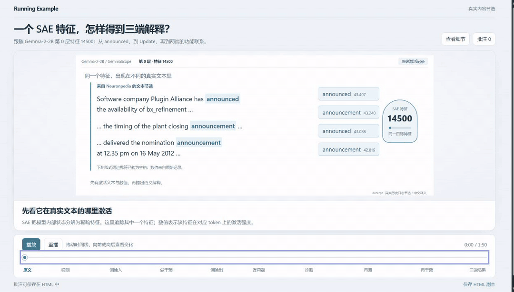

# IPODev · Running Example

通过一个具体例子，展示某个流程从最初内容到最终结果的变化。agent 根据需求自由设计 HTML/SVG 排版和动画；随包播放器提供时间线、播放控制、细节查看和批注。

## 交互示例

[](https://THUFanZd.github.io/IPODev/sae-triplet.html)

**[打开交互演示：一个 SAE 特征，怎样得到三端解释？](https://THUFanZd.github.io/IPODev/sae-triplet.html)** · [HTML 文件](docs/sae-triplet.html)

这里展示的是 [SAE_auto](https://github.com/ldwww-divesss/SAE_auto) 仓库中 agent 解释特征的流程。示例追踪同一个 SAE 特征，从观察激活、提出假设，到测试、干预和修正，最终得到输入、输出与功能解释。打开后可拖动时间线、播放、倒退和查看细节。

GitHub README 会过滤脚本，无法在正文中直接运行交互页面；点击上方预览图或链接，即可进入 GitHub Pages 上的完整 HTML。在线演示可添加本地批注并导出 HTML 副本，直接写回文件需使用下方的本机服务。

## 默认生成什么

- 打开就看到一个具体案例，拖动时间线向前或倒退，看同一批对象被处理、移动、拆分或汇合。
- 可播放、暂停、重播、跳转到关键时刻；简短文字解释当前动作和结果含义。
- 完整数据、Prompt、代码和设计假设按需展开。
- 在当前时刻批注，保存至 HTML 与 feedback.json，再交给 agent 调整。

不要求 IPO 三栏或逐步进入详情。skill 名称保留 ipo-dev，默认产物已经改为 running example 页面。具体流程和业务内容由 agent 设计；播放器没有内置报销等业务案例。

## 使用

把下面的话交给能读文件和运行 Node.js 的 agent：

```text
请完整读取 <仓库绝对路径>/skills/ipo-dev/SKILL.md，按这个 skill 工作。

需求：用一个具体例子展示 Markdown 笔记如何根据查询词得到搜索结果。
先生成可拖动时间线的运行示例页面，输出到当前项目的 example-preview，
不要实现真实搜索服务。
```

agent 读取需求和材料，选择案例并设计 `story.json`、`scene.html`、`scene.css`、`scene.js`，然后运行：

```sh
node <skill>/scripts/build-running.mjs --project <输出目录> --output data.html
node <skill>/scripts/serve-running.mjs --project <输出目录> --output data.html --port 4341
```

打开服务显示的本机地址。HTML 包含所有脚本样式，也可独立打开，不需要 CDN 或 npm install。文件名可按内容选择，构建和预览使用同一个 --output；省略时默认 index.html。Node.js 18+；随包 GSAP 的来源和许可保存在 assets/vendor/NOTICE.md。

需求不完整时，agent 先给出连贯设计，并注明影响结果的假设，供你通过页面对齐。案例明确区分实际内容、真实节选与示意数据。

## 批注与迭代

通过本机服务保存批注，会写入输出目录内所选的 HTML 与 feedback.json。离线时使用“保存 HTML 副本”，把导出的文件交给 agent：

```text
请读取 example-preview/data.html 中的 running-feedback，按批注修改展示方案并重新生成页面。
```

批注记录 cueId、时间和可选对象 ID。agent 保留旧批注并写入 agentReply。修改源文件前停止保存服务，重建后重启。添加批注不会自动发起模型调用；需要回到对话中提出修改要求。

## 结构

```text
skills/ipo-dev/
  SKILL.md                       默认生成流程和设计要求
  references/running-example.md  自由场景、时间线、批注接口
  assets/running.html            画布外框和控制界面
  assets/running-player.js       通用播放器及批注交互
  assets/vendor/                 随包 GSAP
  scripts/build-running.mjs      打包成单文件 HTML
  scripts/serve-running.mjs      本机预览和批注保存
prototypes/running-example/       早期报销视觉样板，供比较，不是 skill 的案例要求
tests/                           新播放器与旧版兼容测试
docs/sae-triplet.html            SAE 特征解释交互示例，GitHub Pages 发布目录
```

旧的 schema v2 / render.mjs / serve.mjs / review.html 留作维护已有 IPO 产物；仓库根目录 project.json、index.html 属于旧示例。新任务使用上面的 running 入口。

## 验证

```sh
node --test tests/*.test.mjs
```

测试覆盖构建、脚本解析、内容引用、批注读回与保存冲突。实际生成质量还需用新需求调用 skill，并在浏览器检查布局、拖动与动画。页面本身不会调用模型，生成和修改由使用 skill 的 agent 完成。
